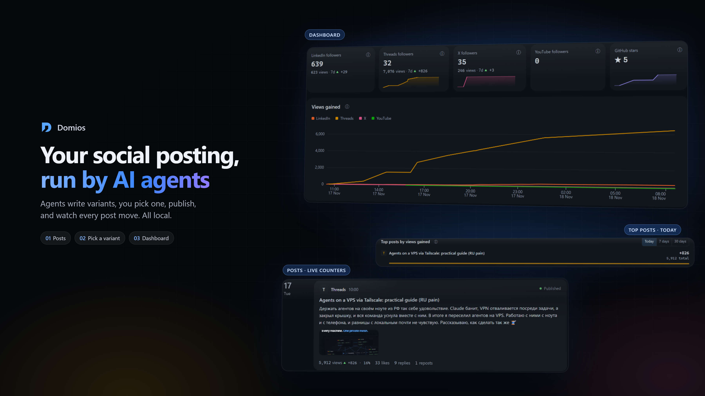
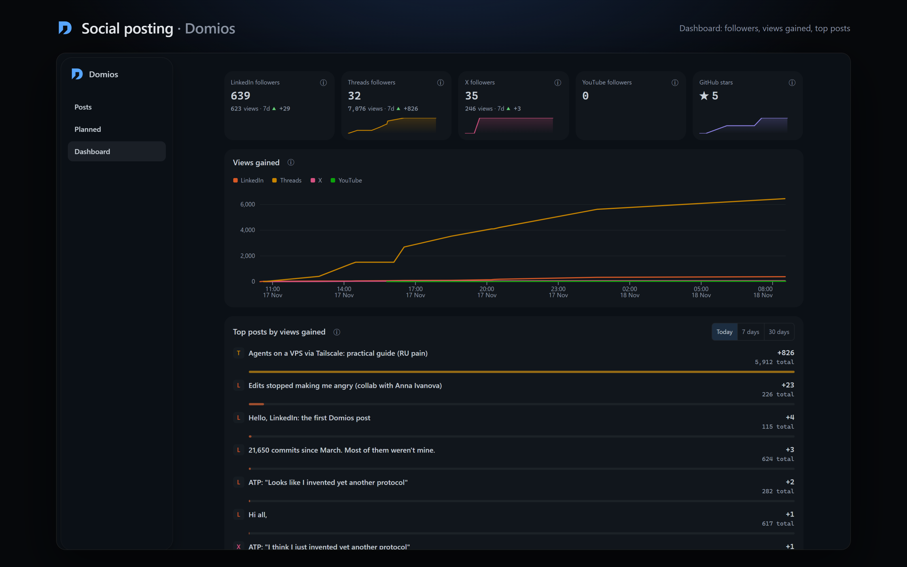
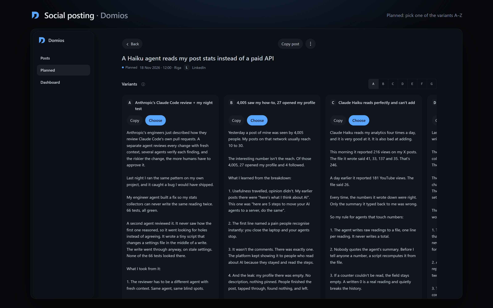

# Domios prototype teams

Experimental agent teams for [Domios](https://domios.dev), packaged with the open [Agentic Team Protocol (ATP)](https://github.com/domios-dev/agentic-team-protocol).

These teams come from real day-to-day work. They are useful, but not yet hardened like the [official teams](https://github.com/domios-dev/domios-teams). Expect rough edges, and tell us what breaks.

## Media team (`rollacode/media-team`)

A content team for any product. You say "start". It looks at your project, uses whichever social accounts you already have (even just one), and:

- **builds you a local catalog and dashboard:** every post, its state and live counters, followers and views gained per channel, top posts, and site traffic if you have analytics;
- **plans posts a few days ahead,** with **5 variants per post**, each a different angle. You compare them side by side, tell the producer which one to use, and reject the rest;
- **writes posts grounded in something real:** an event, a hard number or a step-by-step fix. Never generic thought leadership;
- **collects metrics on a schedule, read-only,** scripted first with an agent as fallback. Every number is checked against the raw data before anyone sees it, and unknown values stay hidden instead of showing as 0;
- **makes covers and short clips** from your real product UI.

You publish. Nothing goes public without your OK, and there is no paid spend.

| | |
|---|---|
|  |  |

### Who is on the team

| Role | Kind | What it does |
|---|---|---|
| Producer | manager | Owns the plan, every post's text and the final word on every number |
| Design lead | manager | Visual direction, numbered specs, live look verdicts |
| Engineering lead | manager | Data contracts, collectors, storage integrity, the app backend |
| writer, analyst, collector, data_engineer, implementer, reviewer, video_editor | workers | Started on demand for bounded tasks |

The docs the agents read live in [`media-team/docs/`](media-team/docs). They are general and not tied to one product:

- `content-playbook.md`: the weekly loop, the content formula, variants and owner gates;
- `catalog-app.md`: building the local catalog and dashboard from an empty folder;
- `catalog-ui.md`: how the catalog looks and behaves;
- `metrics-pipeline.md`: channels, append-only snapshots, baselines and honest comparisons;
- `design-review.md`, `video-pipeline.md` and `engineering-contracts.md`.

## Install

1. Install [Domios](https://domios.dev).
2. Download `media-team.team` from the [latest release](../../releases/latest).
3. Double-click it, or import it in Domios. Then start the team in your product's folder and say "start".

No setup fields are required. Leave them empty and the producer figures out the product, your language, your timezone and your channels.

You can also add this repository as a team channel in Domios: its root `channel.json` follows the same format as the official channel.

## Safety

The teams are plain text: YAML plus Markdown instructions. There are no binaries, no credentials and no tokens. Read them, or point an agent at this repo and ask it to check. Collectors are read-only and never post, like or follow anything on your behalf.

## License

Apache-2.0. See [LICENSE](LICENSE).
